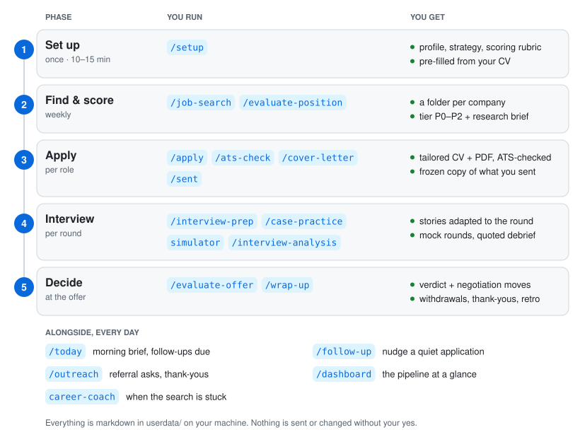

# ai-job-offer

[](https://github.com/markd888/ai-job-offer/actions/workflows/harness-checks.yml)
[](CHANGELOG.md)
[](LICENSE)

**A local-first job-search workflow for product managers, built as a Claude Code plugin.**

It takes you from finding roles to deciding on an offer: it scores each posting against your own rubric, tailors your CV without inventing facts, keeps applications from going quiet, prepares you for each interview round and tells you plainly when the search itself isn't working. Your search lives in markdown files on your machine. Nothing is sent to an employer on your behalf.

[Quick start](#quick-start) · [How it works](#how-it-works) · [Your data](#your-data-and-what-leaves-your-machine) · [Skills](#skills-and-agents) · [Limitations](#known-limitations) · [Contributing](#contributing)

<picture>
  <source media="(prefers-color-scheme: dark)" srcset="docs/how-it-works-dark.svg">
  
</picture>

## Why it works this way

A job search is a pipeline of small decisions spread over weeks: which roles are worth it, what to say in each application, who to chase, how to prepare, when to give up on a lead. Most tools cover one step — a tracker, a CV generator, a prompt library, or a bot that applies for you. This plugin covers the whole loop and keeps you in charge of every step.

- **One workflow, end to end.** Discover → evaluate → apply → interview → decide → improve, with each step reading what the previous one wrote.
- **Your criteria, not a generic score.** Roles are scored against the rubric, hard filters and anti-goals you set in `/setup`, and you can override any score.
- **Markdown is the system of record.** Profile, pipeline, notes and briefs are plain files you can read, edit and version yourself. The dashboard is a view over those files, not a database.
- **No invented facts.** Every claim in a CV, letter or message traces to your master CV, your profile or your own answers.
- **Drafts, not actions.** Follow-ups, referral asks and withdrawals are drafts you send yourself. A status changes after you confirm it.
- **It notices when the search isn't working.** Weekly reflection, a funnel by channel, a monthly look at where rejections cluster and an honest `career-coach` turn your own numbers into a change of strategy.

It is built for senior PMs, lead PMs and heads of product; the default rubric, archetypes and story types are tuned for that search.

## Quick start

**You need:** [Claude Code](https://docs.claude.com/en/docs/claude-code/overview). That's enough for discovery, scoring, tracking, interview prep and coaching. CV and cover-letter PDFs and the ATS check also need Python packages — see [Requirements](#requirements).

**1. Install the plugin** — inside Claude Code:

```sh
/plugin marketplace add https://github.com/markd888/ai-job-offer.git
/plugin install job-offer@job-offer
```

**2. Add your CV.** In the folder you'll run your search from, save your CV as markdown at `userdata/cv.md`. It becomes the only source of facts for tailored CVs and letters, and it lets setup pre-fill most answers.

**3. Run setup** — a guided conversation of about 10–15 minutes: target titles and industries, geography, salary floor, hard filters, timeline.

```sh
/job-offer:setup
```

It writes `userdata/profile.md` and `userdata/strategy.md`, which every other skill reads. You can re-run it any time.

**4. Find and score roles**

```sh
/job-offer:job-search                         # weekly sweep: new roles that match your profile
/job-offer:evaluate-position <posting URL>    # or score one posting you already found
```

Each role that passes your hard filters is filed under `userdata/companies/<Company>/` with a tier (P0–P2) and a short research brief.

**5. Look at what it found**

```sh
/job-offer:dashboard                          # http://localhost:7890
```

Or open the company folders directly. Decide which roles to go for.

**6. Apply**

```sh
/job-offer:apply <Company>                    # tailored one-page CV, built to PDF and ATS-checked
/job-offer:sent <Company>                     # after you send it: records the date and channel, starts the follow-up clock
```

From then on, run `/job-offer:today` each morning: it asks what changed, then gives you the top three actions and any follow-ups due. `/job-offer:help` prints a one-page map of every skill.

### What a result looks like

This is part of a research brief from the fictional example persona in [`userdata/examples/maya/`](userdata/examples/maya/) — a senior PM in London looking at consumer fintech:

```markdown
## Why this fits

**P1 — consumer-finance fit is real, role-shape less so.**

- **Domain:** Consumer finance, chat-first, US/UK — matches my positioning on paper.
- **Skills carry over:** Activation-funnel work at the SaaS unicorn (4.1% → 6.8% conversion)
  is the same shape as what this role owns.
- **Size:** 180 ppl is over my preferred 80-150 ceiling. Tested deliberately.
```

The same folder shows the rest of a working install: [the role's `meta.md`](userdata/examples/maya/companies/Cleo/meta.md), [interview prep](userdata/examples/maya/companies/Cleo/interview-prep-2026-05-05.md) and [a debrief](userdata/examples/maya/companies/Cleo/interview-debrief-2026-05-07-hm.md), [a tailored CV](userdata/examples/maya/companies/Lendable/cv-2026-05-18.md) and [a daily brief](userdata/examples/maya/outputs/daily-brief-2026-05-18.md).

## How it works

| Stage | What happens | Commands |
|---|---|---|
| **Discover** | Weekly sweep of public ATS job boards (Ashby, Greenhouse, Lever) and optional Freehire; companies you track are rechecked, roles you've already seen are skipped. | `/job-search` |
| **Evaluate** | A posting's requirements are checked (met, not met, or unknown), the fit is rated against your CV with quoted evidence, the company is rated separately, the role is tiered P0–P2 and checked for signs it's stale. The first prediction is kept so you can later compare it with what happened. | `/evaluate-position` |
| **Apply** | Your master CV is tailored to the role, built into a one-page PDF and read back the way a parser reads it; a short cover letter if needed; a frozen copy of what you sent. | `/apply`, `/ats-check`, `/cover-letter`, `/sent` |
| **Follow up** | Applications quiet for 10+ days get a short nudge (at most two); referral asks and thank-yous are tracked per person. | `/follow-up`, `/outreach` |
| **Interview** | Stories adapted to the round, take-homes held to the brief's limits, case drills, mock interviews, and a debrief from your transcript. | `/interview-prep`, `/take-home`, `/story-builder`, `/case-practice`, `/interview-analysis` |
| **Decide** | A verdict on one offer or two, with negotiation moves; after you accept, withdrawals, thank-yous and a retro. | `/evaluate-offer`, `/wrap-up` |
| **Improve** | A weekly reflection, the funnel by channel, a monthly rejection review, and a coach that proposes changes (positioning, stories, roles to stop applying to) when the strategy needs one. | `/today`, `/dashboard`, `career-coach` |

Each role is a folder with a `meta.md`. Its `status` moves `new → to_apply → applied → interviewing → offer`, or ends in `rejected` / `not_interested`; skills propose the change and you confirm it.

## Your data and what leaves your machine

Everything the plugin keeps is plain markdown under `userdata/` in your search folder. The folder is gitignored by default.

```text
userdata/
├── cv.md                    master CV — the only source of facts for every CV and letter
├── profile.md               targets, rubric, hard filters, positioning, tone
├── strategy.md              weekly cadence, anti-goals, search state
├── journal.md               dated log of everything you confirmed
├── stories/                 STAR-story bank
├── people/                  referrers, recruiters, hiring managers and every ask
├── companies/<Company>/     meta.md, scoring files, research brief, tailored CVs, ATS reports,
│                            the frozen copy of what you sent, prep and debriefs
└── outputs/                 daily briefs, applications index, retrospective
```

Local storage doesn't mean nothing leaves your machine. Here is what does, and when:

| What | Where it goes | When |
|---|---|---|
| The files and messages Claude works with | The model provider your Claude Code uses (Anthropic by default) | Always — that's how Claude Code works |
| Search queries, posting URLs, company pages | The public web and public ATS job-board APIs | `/job-search`, `/evaluate-position`, research |
| Search filters from your profile (titles, seniority, countries, salary floor) | [Freehire](https://freehire.me) | Only if you connect the Freehire MCP |
| Calendar, email, meeting notes; pipeline or digests | The services you connect | Only with an MCP integration you set up |
| A random install ID and the plugin version, once | `job-offer.mark-d.dev` | Only if you say yes to the install count in `/setup` |
| A read-only snapshot of your role cards | Your own Cloudflare account, behind Cloudflare Access | Only if you deploy the optional cloud dashboard |

Nothing is sent to an employer, recruiter or contact by the plugin. The install count stores no IP or user agent and can be turned off any time with `"consent": false` in `userdata/telemetry.json` or `JOB_OFFER_TELEMETRY=0`. The dashboard listens on `127.0.0.1` only.

## Skills and agents

All commands are prefixed `/job-offer:`. Full descriptions are in [`plugin/README.md`](plugin/README.md).

<details>
<summary><b>20 skills</b> — by stage</summary>

| Stage | Skill | What it does |
|---|---|---|
| Start | `/setup` | Guided setup → profile, strategy, workspace `CLAUDE.md`. Pre-fills from your CV; re-runnable. |
| | `/help` | One-page map of every skill and agent. |
| | `/integrations` | Finds Granola, Calendar and Gmail MCPs and wires the ones you have. |
| Daily | `/today` | What changed, then the brief: top three actions, pipeline, follow-ups due. |
| | `/dashboard` | The pipeline in a browser; change status and add notes inline. |
| Discover | `/job-search` | Weekly sweep of ATS job boards (and Freehire if connected); scores and files new roles. |
| Evaluate | `/evaluate-position <url>` | Requirements check, evidence-backed fit, company rated apart, tier, posting liveness, research brief. |
| Apply | `/apply <Company>` | Tailors the master CV: up to five questions, one draft, a one-page PDF. |
| | `/ats-check <Company>` | Reads the CV (PDF or DOCX) the way a parser does: integrity, what each field parses into, fidelity against your CV, the posting's requirements with quoted evidence, layout risks. States what it can't predict. |
| | `/cover-letter <Company>` | 150–250 words answering the posting's top needs, each claim traced to the CV. |
| | `/sent <Company>` | Records status, date, channel and referrer; freezes what you sent. |
| | `/follow-up [Company]` | Drafts a nudge for quiet applications, or a thank-you after a round. |
| | `/outreach <person or Company>` | Referral asks, intros and thank-yous; one record per person. |
| Interview | `/story-builder` | STAR-story bank; `--gap-check` finds missing senior-PM story types. |
| | `/interview-prep <Company>` | Adapts 3–5 stories to the round, from recruiter screen to final loop. |
| | `/take-home <Company>` | Reads the brief's limits (word cap, how many requirements, assumptions, AI policy, deadline or time box), keeps an assumptions log, checks your draft against them, runs the reviewer panel and keeps a copy of what you sent. Writes none of it when the brief rules out AI tools. |
| | `/case-practice [Company]` | Rapid-recognition case drill against an 80% readiness gate. |
| | `/interview-analysis` | Debrief from a transcript (pasted, file or Granola), quoted. |
| Decide | `/evaluate-offer` | Comp shape, archetype fit, anti-patterns and 3–5 negotiation moves. |
| | `/wrap-up` | Withdrawals, thank-yous, a retro, then quiet mode; `--reopen` resumes. |

</details>

**Agents** — ask for them by name or in plain words ("review this case study as a CPO", "I'm stuck"):

| Agent | Use it for |
|---|---|
| `cpo-reviewer`, `eng-manager-reviewer`, `design-manager-reviewer`, `interview-coach` | Reviews of a case study, story or answer from four angles, in one shared format, so you can read them as a panel |
| `interviewer-simulator` | A full mock round, or one question with escalating follow-ups |
| `career-coach` | Positioning, outreach, cadence, offers, a monthly rejection review, and resetting a search that isn't working |

## Dashboard

A browser view over the same markdown files, for scanning the pipeline. It writes back two things only: status changes and notes.


```sh
/job-offer:dashboard    # http://localhost:7890 — reused if already running; ctrl-C to stop
```

A read-only copy for your phone can run on Cloudflare Workers behind Cloudflare Access — see [`plugin/dashboard/README.md`](plugin/dashboard/README.md). Full-quality video: [docs/dashboard-demo.mp4](docs/dashboard-demo.mp4).

## Integrations

All optional; the plugin works without any of them. Each is a prompt pattern over an MCP server you already run — details in [`plugin/INTEGRATIONS.md`](plugin/INTEGRATIONS.md).

| Connect | What it adds |
|---|---|
| Granola | Interview transcripts for `/interview-analysis`; recordings to confirm in `/today` |
| Gmail | Recruiter replies, rejections and offers to confirm in `/today` |
| Google Calendar | Upcoming interviews in the brief; new or moved events to confirm |
| Freehire | Live postings from company career pages as a `/job-search` source |
| Playwright | Checks that postings are still live |
| Notion | The pipeline as a database, synced on demand |
| Slack, Telegram, Discord | `/today` digests to an accountability channel |

## Requirements

| For | You need |
|---|---|
| Everything except PDFs | Claude Code |
| CV and cover-letter PDFs | Python 3 with `reportlab`, and the Carlito font |
| ATS check | `pypdf` (or poppler's `pdftotext`) |
| Dashboard | Python 3 (standard library) |
| Cloud copy of the dashboard | Node, `wrangler`, a Cloudflare account with Access |

```sh
pip install "reportlab>=4.0" "pypdf>=4.0"
# Carlito: download from Google Fonts on macOS, or on Debian/Ubuntu:
sudo apt install fonts-crosextra-carlito
```

Without them, `/apply` still writes the tailored CV in markdown and tells you the PDF step was skipped. CI runs on Python 3.12.

## Known limitations

- **Tuned for senior product roles.** The default rubric, archetypes and story types assume a senior PM / head of product search. Other role families need their own rubric.
- **The ATS check is a simulation, not a vendor's parser.** It shows what bounded heuristics extract from your PDF or DOCX, how the fields compare with your CV, and which posting requirements your experience shows, with quotes. It doesn't predict any ATS ranking. It can't judge depth or years of experience, and layout risks are observations from the text layer.
- **Scores are judgement, not prediction.** The fit rating comes from Claude matching the posting's requirements to quoted lines of your CV; `scripts/score.py` does the arithmetic. Check it before acting: a fit score is not a probability of getting an interview. `funnel.py --by-tier` shows whether the predictions held up, once you have five or more applications per tier.
- **Rejection patterns show where, not why.** `rejection-patterns.py` finds where rejections cluster (stage, predicted tier, role level, time to rejection). Most rejections are silence or a template, so the reason comes only from your interview debriefs and the few specific notes. Channels show up only once applications are recorded with `/sent`.
- **CV output is one fixed format:** a single-column, one-page A4 PDF in Carlito ([#12](https://github.com/markd888/ai-job-offer/issues/12) tracks options).
- **Discovery isn't exhaustive.** The sweep reaches public ATS boards and, with Freehire, more career pages; roles posted only on closed boards can be missed.
- **Requires Claude Code.** There is no standalone app.

## job-sweep: only the weekly role list

A second, standalone plugin in this repo for one command and nothing else: a weekly list of open product roles that match you, minus everything it already showed you. No pipeline, no scoring, no company folders.

```sh
/plugin install job-sweep@job-offer     # after adding the marketplace above
/job-sweep:sweep
```

Move to the full plugin later and `/setup` reads `job-sweep/profile.md`, so you won't answer the same questions twice. See [`plugin-sweep/README.md`](plugin-sweep/README.md).

## Project status

Active, single-maintainer, versioned with [semantic versioning](https://semver.org/); release notes in [CHANGELOG.md](CHANGELOG.md) and on [GitHub Releases](https://github.com/markd888/ai-job-offer/releases). Latest: **0.9.0** — `/take-home`: take-home assignments held to the brief's limits and AI policy, with a reviewer panel. Before it: evidence-based scoring (0.8.5), the ATS compatibility and parsing simulator (0.8.6), `SECURITY.md` and issue forms (0.8.7), rejection patterns feeding back into positioning (0.8.8). No release is planned next; ideas and bugs go to [issues](https://github.com/markd888/ai-job-offer/issues/new/choose).

This project started as a fork of [pm-job-search](https://github.com/archugunov/pm-job-search) 0.6.0 by [@archugunov](https://github.com/archugunov). Since then it added PDF output and the ATS check, cover letters, `/sent` with a frozen copy of each application, follow-ups and referral tracking, the funnel by channel, `/wrap-up`, Freehire discovery and a reworked dashboard.

## Contributing

Bug reports, fixes and ideas are welcome. [CONTRIBUTING.md](CONTRIBUTING.md) covers running the plugin from a clone, the test suite, and the privacy rule: no personal data in the repo, enforced by a CI scan.

[Open an issue](https://github.com/markd888/ai-job-offer/issues/new/choose) with the bug or feature form: they ask for the skill you ran, the plugin version, and what you expected and got, and remind you to leave out your own CV, profile or company notes — the tracker is public. For a vulnerability, report privately instead; [SECURITY.md](SECURITY.md) explains how, and what the plugin can touch.

## License

MIT — see [LICENSE](LICENSE).
