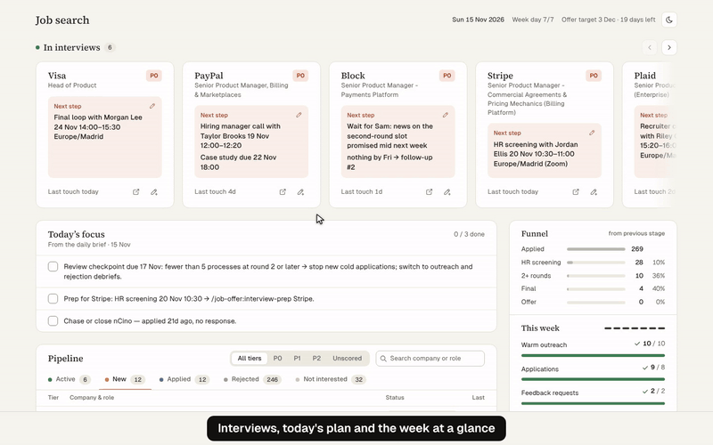

# ai-job-offer

Mark D's version of [pm-job-search](https://github.com/archugunov/pm-job-search) by [@archugunov](https://github.com/archugunov) (MIT), forked from 0.6.0. On top of the original it adds:

- **CV to PDF from markdown** (`plugin/scripts/cv-build.py`, reportlab + Carlito), plus a matching cover-letter builder. `/job-offer:apply` builds the PDF right after drafting the CV.
- **ATS check** (`/job-offer:ats-check`): reads the PDF's text layer the way an applicant tracking system does and checks pages, contacts, glyphs, section order, extraction fidelity and keyword coverage. Runs after every CV build.
- **Recording what was sent** (`/job-offer:sent`, `plugin/scripts/record-sent.py`): one step after your yes sets the status, date and channel (and who referred you) and freezes the CV, cover note, ATS check and posting in `submitted-<date>/`.
- **Follow-ups** (`/job-offer:follow-up`, `plugin/scripts/follow-ups.py`): lists applications quiet for 10+ days and drafts a follow-up or a thank-you; `/job-offer:today` flags what's due.
- **Reworked dashboard**: goals from `strategy.md`, interviews above today's focus, a read-only cloud copy on Cloudflare Workers. Always on `http://localhost:7890`, reused if it's already running.

A Claude Code plugin for senior product leaders running a job search. Finds open roles, scores fit, tracks your pipeline, runs live interview practice, and gives you an honest career coach. Markdown by default — optional browser dashboard and MCP integrations on top.

Built for senior PMs, lead PMs, and heads of product. Everything inside is shaped around how that search actually runs; a different role can fork the architecture, but the defaults will need rework.

- **Lean.** Markdown at the core: the pipeline, skills and agents need nothing installed. One `/setup` and you're running. Everything lives in `.md` files under `userdata/`, gitignored by default and editable by hand. The CV PDF and ATS check add a small Python toolchain — see [Requirements](#requirements).
- **Tailored to the senior-PM context.** Reviewer agents play the four people who'll actually interview you, and a simulator runs mock rounds. Offer evaluation checks the role's stage against how you operate — builder, scaler, or operator — and flags hollow-HoP risk before you sign.
- **Honest.** When the search itself isn't working, `career-coach` says so: eight weeks in with one thread, it tells you adjusting cadence won't fix it.

## Install

```sh
# inside Claude Code, in any workspace:
/plugin marketplace add https://github.com/markd888/ai-job-offer.git
/plugin install job-offer@job-offer

cd <your-workspace>
/job-offer:setup     # 10-15 min — identity, target role, salary, hard filters, target date
```

Then `/job-offer:today` every morning, and `/job-offer:help` anytime for a one-page map of every skill and agent.

## Requirements

| What | Needs | Install |
|---|---|---|
| Pipeline, scoring, prep, coaching | Claude Code only | — |
| CV and cover-letter PDF (`cv-build.py`, `cover-letter-build.py`) | Python 3.10+, `reportlab`, the Carlito font | `pip install -r plugin/scripts/requirements.txt`; Carlito: macOS Font Book (download from Google Fonts), Debian/Ubuntu `apt install fonts-crosextra-carlito` |
| ATS check (`ats-check.py`) | `pypdf`, or poppler's `pdftotext` | included in `requirements.txt` |
| Follow-ups, application archive | Python 3.10+, standard library only | — |
| Dashboard | Python 3 (standard library); Node only to rebuild the bundle | — |
| Cloud copy of the dashboard | Node, `wrangler`, a Cloudflare Access application | see [`plugin/dashboard/README.md`](plugin/dashboard/README.md) |

Without the Python packages `/job-offer:apply` still writes the tailored CV markdown; it says the PDF step was skipped and why.

## job-sweep — just the weekly role list

A second, standalone plugin in this repo for people who want one job-search command and nothing else. One output: a weekly list of open product roles that match you, minus everything it already showed you. No pipeline to maintain, no tier rubric, no company folders.

```sh
/plugin marketplace add https://github.com/markd888/ai-job-offer.git
/plugin install job-sweep@job-offer
/job-sweep:sweep
```

Want the tracking, scoring and interview prep later? Install the full plugin — `/setup` reads your `job-sweep/profile.md`, so you won't answer the same questions twice. See [`plugin-sweep/README.md`](plugin-sweep/README.md).

## How it works

Five phases, plus what runs alongside them.

1. **Set up once.** `/job-offer:setup` writes your profile, strategy, and the rubric everything else scores against. Drop a CV at `userdata/cv.md` first and it pre-fills most answers.
2. **Discover & score.** `/job-offer:job-search` runs a weekly sweep — parallel subagents recheck your P0/P1 companies via ATS APIs and discover new roles via scoped search. `/job-offer:evaluate-position <url>` scores one-off postings. Both write a company folder, a tier score, and a 200-word research brief.
3. **Apply.** `/job-offer:apply <Company>` tailors your master CV for one role, and `/job-offer:cover-letter <Company>` writes a short letter to go with it when one is needed. Every claim traces to your CV, your profile, or your own answers — they never invent facts.
4. **Interview.** `/job-offer:interview-prep <Company>` adapts stories from your bank for a specific round. Rehearse with `job-offer:interviewer-simulator`, debrief with `/job-offer:interview-analysis`.
5. **Decide.** `/job-offer:evaluate-offer` sense-checks an offer or compares two — verdict, comp shape, archetype fit, negotiation moves. Once you accept, `/job-offer:wrap-up` closes the search properly and turns the nudges off.

Alongside: `/job-offer:today` (morning brief), `job-offer:career-coach` (anytime you're stuck), `/job-offer:dashboard` (visual pipeline), `/job-offer:story-builder` (your STAR-story bank).

## Skills

| Skill | What it does |
|---|---|
| `/job-offer:help` | One-page map of the workflow, every skill, and every agent. Also written to `userdata/help.md`. |
| `/job-offer:setup` | Nine steps — profile, strategy, workspace `CLAUDE.md`. Re-runnable. Pre-fills from a CV. |
| `/job-offer:today` | Two-phase daily ritual. Scans Calendar/Gmail/Granola for pipeline deltas and asks you to confirm, then writes the brief: top 3 actions, pipeline, heads-up. |
| `/job-offer:dashboard` | Browser view of the pipeline. Inline status changes and notes per company. |
| `/job-offer:evaluate-position <url>` | Score a posting against your tier rubric. Hard-filter and anti-goal gates, liveness check, user override. |
| `/job-offer:job-search` | Weekly sweep. Rechecks your tracked companies via public ATS APIs (Ashby / Greenhouse / Lever), discovers new roles via scoped search, scores and files them. |
| `/job-offer:apply <Company>` | Tailor your master CV for one role. Up to five clarifying questions, then a single-pass draft. |
| `/job-offer:cover-letter <Company>` | A 150–250-word letter answering the posting's top two or three needs with one proof each. Every number and name is checked against your CV and profile; it tells you what it did not claim. |
| `/job-offer:story-builder` | Your universal STAR-story bank. Each story carries 3-5 angles for different question types. |
| `/job-offer:interview-prep <Company>` | Adapt 3-5 stories for a specific round. `--stage` shapes the prep; late rounds add founder-vetting questions. |
| `/job-offer:case-practice [Company]` | Rapid-recognition case drill. Every pick scored with the failure mode it demonstrates, tracked against an 80% readiness gate. |
| `/job-offer:interview-analysis` | Post-interview debrief from a transcript. Anchors findings to quotes: what landed, what didn't, deltas vs your prep. |
| `/job-offer:evaluate-offer` | Sense-check an offer or compare two. Verdict, comp shape, archetype fit, anti-pattern scan, negotiation moves. |
| `/job-offer:wrap-up` | Close the search after you accept an offer: withdrawals, thank-yous, a retrospective from your own numbers, then quiet mode. Every step waits for your yes; `--reopen` starts again. |
| `/job-offer:integrations` | Probes for Granola / Calendar / Gmail MCPs and wires the ones you have. Optional — the plugin works fine without them. |

## Agents

Four reviewers, one strategic coach, one interview-practice simulator. The reviewers share the same four-section output — what works, what doesn't, where it sounds weak from that lens, one rewrite suggestion. Run two to four in parallel and read them as a panel.

| Agent | Lens |
|---|---|
| `cpo-reviewer` | Strategy, scale, business model, judgement under uncertainty |
| `eng-manager-reviewer` | Technical feasibility, engineering trade-offs, collaboration with engineers |
| `design-manager-reviewer` | UX judgement, craft, discovery rigour, how designers are treated |
| `interview-coach` | Narrative, clarity, voice authenticity, how you come across |
| `career-coach` | Positioning, outreach, anti-goals, cadence, offers, search resets. Honest-calibration mode gives the assessment most tools dodge. |
| `interviewer-simulator` | Plays the interviewer — full mock round, single-question deep-dive, or pressure-test against one story's weak angle. |

Each agent keeps project-scoped memory at `.claude/agent-memory/<agent>/`. Reviewers take `--save <Company>` to write the review into the company folder.

`career-coach` is the home for deeper strategy work. `/setup` writes a basic `strategy.md` and leaves anti-goals, checkpoints and rubric calibration for a conversation when you want it. Invoke by natural language — "got an offer to weigh", "I'm stuck and don't know why".

## Dashboard

A browser view of your pipeline that reads the same markdown files as every other skill — for scanning, not acting.



_Full-quality video (20 s):_ [docs/dashboard-demo.mp4](docs/dashboard-demo.mp4)

Interview cards across the top, each with its next step (click to edit). Below them, today's focus from the daily brief and the pipeline by stage with a tier filter and search; on the right, the funnel, this week's targets, coming-up events and the brief's heads-up. Clicking a row opens a company drawer with research, notes, prep docs and debriefs.

```sh
/job-offer:dashboard    # opens a browser tab; ctrl-C to stop
```

React + Mantine, pre-built bundle committed to the repo. Zero install, no Node required at runtime.

It writes back exactly two things: status changes and notes. Everything else is reading — new roles, evaluations, applications and prep docs come from CLI skills, because the model needs to be in the loop.

Already run the Notion MCP? You can sync your pipeline to a Notion database instead and skip the dashboard. See [INTEGRATIONS.md](plugin/INTEGRATIONS.md).

## Integrations

Markdown-only is the default. Wire in MCP servers you already run to make specific skills more capable — each is a prompt pattern, not a plugin code change. See [INTEGRATIONS.md](plugin/INTEGRATIONS.md).

- **Granola** — meeting transcripts into `/interview-analysis`, recordings as confirms in `/today`
- **Gmail** — recruiter replies, rejections and offer language as confirms in `/today`
- **Calendar** — upcoming interviews in `/today`'s heads-up, schedule changes as confirms
- **Notion** — companies as database rows alongside the markdown source
- **Playwright** — link-liveness verification and interviewer research
- **Slack / Telegram / Discord** — pipe `/today` digests to an accountability channel

## Examples

Two fictional personas in `userdata/examples/`, so you can see a working install before running `/setup`: **maya** (senior PM in London, fintech — full install) and **diego** (VP Product in Mexico City chasing remote US roles — skeletal, stress-tests USD comp and no anchor city).

## Privacy + contributing

Your `userdata/` directory is gitignored except for the examples. Anything you put there stays on your machine unless you share it on purpose.

A CI workflow scans every push and PR against the author's personal-data blocklist. If you fork, swap the blocklist for your own terms or drop the workflow.

Contributions welcome — [CONTRIBUTING.md](CONTRIBUTING.md) covers scope, dev install, the privacy rule, and testing conventions.

## Feedback

Found a bug or want a feature? [Open an issue](https://github.com/archugunov/pm-job-search/issues) — include the skill you ran, what you expected, and what happened.

## Licence

MIT. See [LICENSE](LICENSE).
